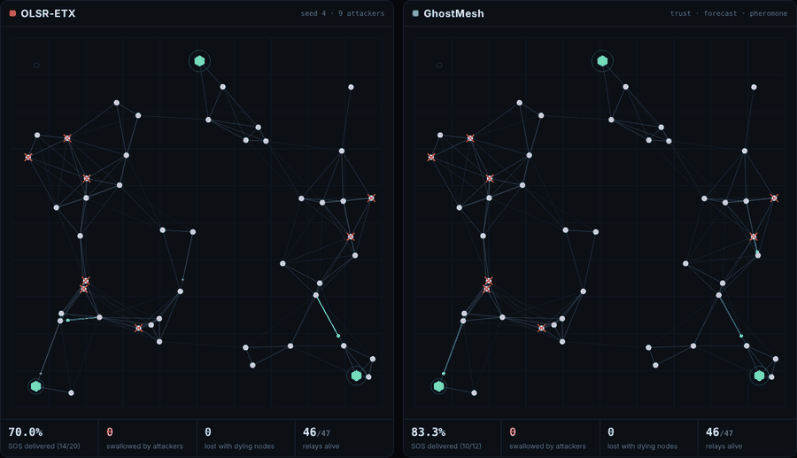
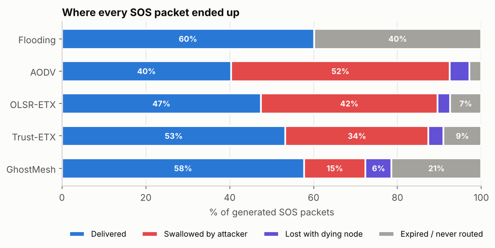
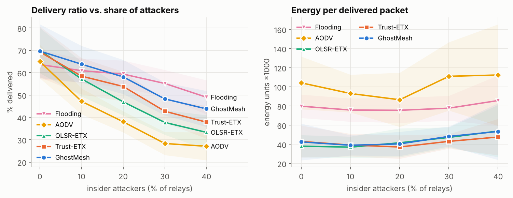
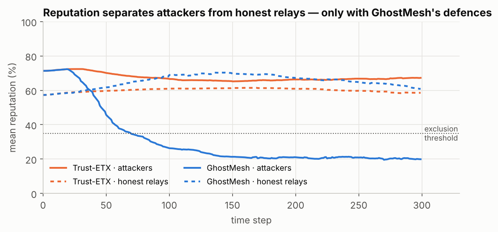
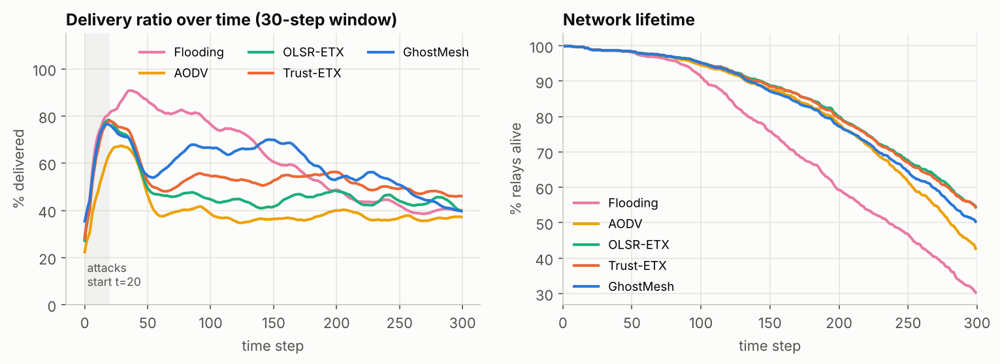
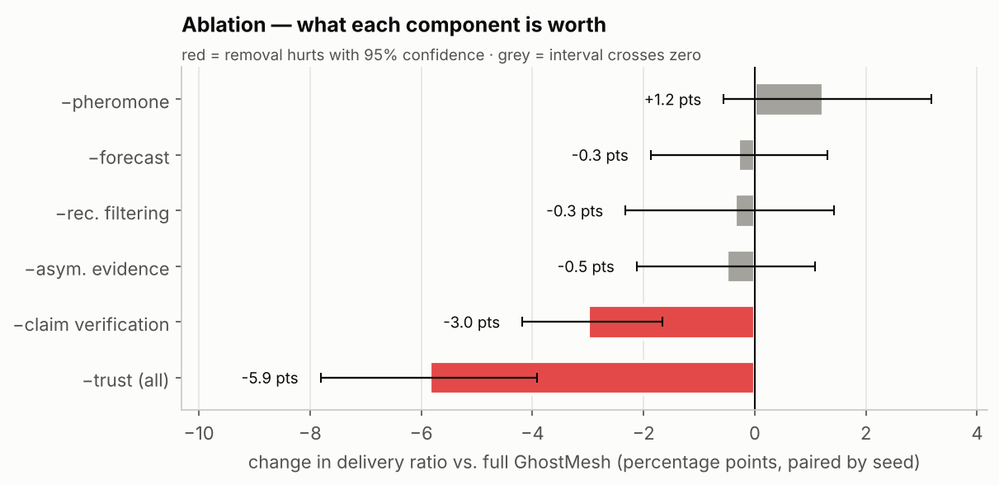
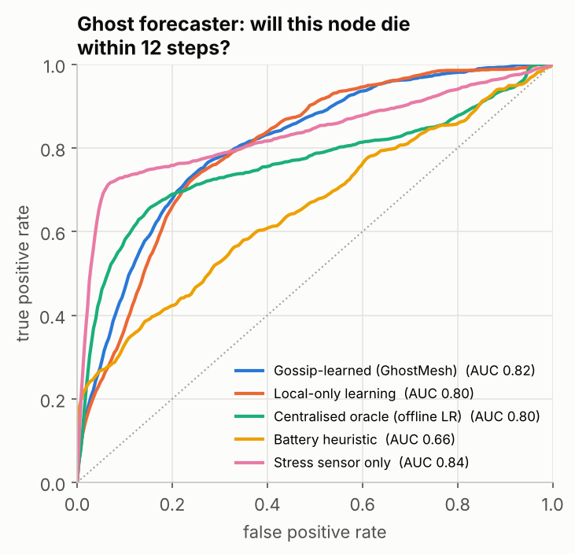
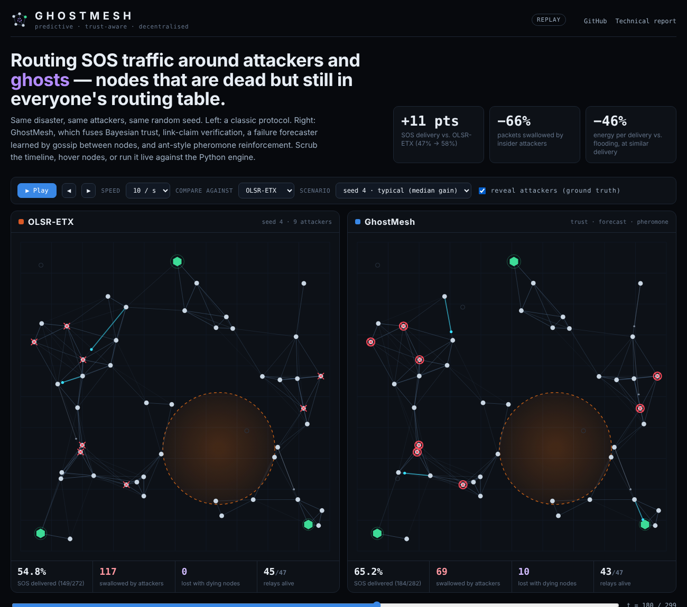

<div align="center">

# GhostMesh

### Predictive, trust-aware routing for decentralised emergency mesh networks

**When the towers go down, phones and sensors relay SOS messages to each other.
Some of those relays are dying. Some are lying. GhostMesh routes around both.**

[](https://github.com/YOUR-USERNAME/ghostmesh/actions/workflows/ci.yml)


[**▶ Interactive demo**](https://YOUR-USERNAME.github.io/ghostmesh/) ·
[**Technical report**](docs/REPORT.md) ·
[**Reproduce every number**](#reproduce-everything)



<sub>Same disaster, same attackers, same random seed. Red crosses are insider attackers (ground truth); red rings are attackers GhostMesh has learned to distrust on its own.</sub>

</div>

---

## In one table

Mean over **20 independent scenarios** (50 nodes, 20% insider attackers, spreading hazard), with 95% bootstrap confidence intervals.

| Protocol | SOS delivered ↑ | Swallowed by attackers ↓ | Energy per delivery ↓ | Relays alive at end ↑ |
|---|---|---|---|---|
| Flooding (epidemic) | **60.3%** [56.2, 63.9] | — ¹ | 75.0 | 30.3% |
| AODV | 40.2% [36.4, 44.1] | 52.3% | 81.6 | 42.7% |
| OLSR-ETX | 47.2% [42.6, 51.7] | 42.5% | 41.5 | **54.6%** |
| Trust-ETX (Beta reputation) | 53.3% [47.9, 58.3] | 34.1% | **38.1** | 54.4% |
| **GhostMesh** | **58.0%** [52.1, 63.6] | **14.6%** | 40.9 | 50.3% |

- **+10.8 points** delivery over OLSR-ETX, better in **20 of 20** scenarios (paired Wilcoxon *p* = 2×10⁻⁶).
- **+4.7 points** over a standard trust-based router, better in 16 of 20 (*p* = 9×10⁻⁴).
- Attackers swallow **66% fewer** packets than under OLSR-ETX.
- Delivery is statistically **tied with flooding** (−2.3 pts, 95% CI [−5.3, +0.9]) at **45% less energy per delivered packet**, leaving **two-thirds more relays alive** at the end.
- **No cost in peacetime**: with zero attackers GhostMesh delivers 69.7% vs. OLSR-ETX's 70.0%.

<sub>¹ Flooding sends copies down every path, so a single attacker rarely kills a message. Its losses come from floods that never reach a gateway.</sub>

---

## The problem

In a disaster, a **mobile ad-hoc mesh** (rescuer handsets, drones, IoT sensors) carries SOS traffic to a few gateways with satellite or drone uplinks. Classic mesh routing assumes every node is honest and long-lived. A disaster breaks both assumptions:

1. **Ghosts.** Nodes die from fire, flood or flat batteries. For several seconds after dying they are still advertised in neighbours' routing tables. Packets handed to a ghost, or to a node about to become one, are lost.
2. **Insiders.** A compromised node can advertise perfect links to attract traffic and then drop it (black-hole), drop some of it (grey-hole), alternate good and bad behaviour to keep its reputation (on-off), and spread lies about honest nodes (bad-mouthing).

## What GhostMesh does

GhostMesh is a hop-by-hop link-state router. Every node computes its own least-cost path to the nearest gateway using an edge cost that fuses four independent signals:

```
cost_u(x → y)  =  ETX(x,y)  ·  T_u(y)^−γ  ·  (1 + κ · risk(y) · wait(y))  /  (1 + ρ · τ(x,y))
                  link        trust          ghost forecast                  pheromone
```

| Component | Idea | Defends against |
|---|---|---|
| **Bayesian trust with asymmetric evidence** | Beta(α, β) belief per neighbour from a watchdog. A drop weighs 1.5× a forward, bad evidence fades about 7× slower than good, and silence on a lossy link counts for less (channel-aware). | grey-holes, on-off attackers |
| **Recommendation credibility** | Second-hand opinions are scored against first-hand experience. Recommenders who keep contradicting what you have seen yourself lose their voice. | bad-mouthing, collusion |
| **Link-claim verification** | Each node checks the link quality its neighbours *advertise* against what it *measures* on the same link. Inflated claims count as misbehaviour. | route-attraction (the black-hole lure) |
| **Gossip-learned ghost forecaster** | Each node runs a logistic model on its own telemetry (battery time-to-empty, heat stress, neighbour churn, link quality). Labels arrive with a delay, neighbours learn from a node's death, and weights are averaged by gossip each step: **federated learning with no server**. Nodes advertise their own failure risk. | handing packets to soon-to-be ghosts |
| **Stigmergic pheromone** | Acknowledged deliveries deposit pheromone on the links they used; misbehaviour wipes it. Inspired by ant-colony routing. | slow adaptation |
| **Ghost evacuation** | A node that predicts its own death and has no route hands its buffer to its safest trusted neighbour (custody transfer). | packets dying with their carrier |

## Results

### Where every SOS packet ended up



GhostMesh cuts losses to attackers from 42% to 15%. The price is visible too: it keeps more packets waiting for a trustworthy route, so slightly more of them expire or die with their carrier. That trade is worth it here (+11 pts net), and it is the honest shape of the result.

### Robustness to the share of attackers



GhostMesh leads every unicast protocol at every non-zero attack level and matches them when there are no attackers. **Flooding wins on raw delivery once 30%+ of relays are malicious**, at nearly twice the energy, which drains the network (next figure).

### Detection: reputation that actually separates attackers



A standard Beta-reputation router (Trust-ETX) is fooled by bad-mouthing: attackers end up with a *higher* reputation than honest relays (detection AUC 0.16, worse than chance). GhostMesh drives attackers below the exclusion threshold within about 50 steps of the attack starting. **Detection AUC 0.88; at a reputation cut-off of 0.4, 86% of surviving attackers are flagged with 8% false positives.**

### Lifetime and delivery over time



### Ablation: what each idea is actually worth



Each bar removes one component and re-runs the *same* 20 scenarios (paired differences).

- **Link-claim verification is the most valuable single idea** (−3.0 pts without it, 95% CI [−4.2, −1.7]). It also drives most of the detection accuracy (AUC 0.88 → 0.60 without it).
- **Asymmetric evidence** and **recommendation credibility** do not move delivery significantly on their own, but removing them lets attackers swallow **+7.7** and **+1.8** points more traffic and lowers detection AUC by 0.08 and 0.11. They are security features whose delivery benefit is partly absorbed by the other defences.
- **Negative results, reported as such:** the ghost forecaster (−0.3 pts) and pheromone (+1.2 pts when *removed*) have **no significant effect on delivery** in these scenarios. Avoiding high-risk relays saves packets from dying nodes but makes more of them wait, and the two effects cancel (see the [technical report](docs/REPORT.md#62-why-the-forecaster-does-not-move-delivery)).

### The ghost forecaster as a learning problem



Will this node die in the next 12 steps? Evaluated online (each prediction is made *before* its label exists) on 58,572 node-steps with 1,877 deaths.

| Forecaster | AUC (10 seeds) |
|---|---|
| **Gossip-learned (GhostMesh)** | **0.817** [0.78, 0.85] |
| Local-only learning (no gossip) | 0.801 [0.78, 0.83] |
| Centralised oracle (offline LR, train-early / test-late) | 0.800 [0.68, 0.88] |
| Battery-level heuristic | 0.658 |
| Single heat sensor | 0.843 |

Gossip averaging beats isolated learning and matches a centralised model trained offline on everyone's data, with no server and no raw data leaving a node. A hand-picked heat sensor is still a strong baseline; the learned model's edge is that it also catches battery deaths, which the heat sensor cannot see.

<br clear="right">

---

## Interactive dashboard



`docs/index.html` is a self-contained page (no build step) that runs in two modes:

- **Replay** (GitHub Pages): plays recorded traces of the median, best and worst scenario for every protocol side by side, with a scrubbable timeline, hover inspector (battery, predicted risk, reputation), an event log and a live delivery chart.
- **Live**: start the FastAPI server and the same page connects over WebSocket to the Python engine. **Click a node to destroy it; shift-click to turn it into an attacker** and watch both protocols react.

## Quickstart

```bash
git clone https://github.com/YOUR-USERNAME/ghostmesh && cd ghostmesh
pip install -r requirements.txt

pytest -q                                # 23 tests
uvicorn server.app:app --reload          # live dashboard at http://localhost:8000
```

Use the engine directly:

```python
from ghostmesh import Config, Simulation

cfg = Config(seed=4, malicious_frac=0.2)           # 50 nodes, fire front, 20% insiders
for router in ["etx", "trust_etx", "ghostmesh"]:
    s = Simulation(cfg, router).run()
    print(f"{router:10s} delivered {s['pdr']:.1%}  swallowed {s['adv_drop_frac']:.1%}")
```

REST endpoints: `GET /api/run?router=ghostmesh&seed=0`, `GET /api/topology?seed=0&step=150` (NetworkX connectivity analysis: components, articulation points, algebraic connectivity, best achievable reachability), `WS /ws`.

## Reproduce everything

```bash
python experiments/run_experiments.py    # 20-seed benchmark, attack sweep, ablation, forecaster (~6 min on 2 cores)
python experiments/make_figures.py       # → docs/figures/*.png, docs/headline.json
python experiments/export_traces.py      # → docs/traces/*.json for the dashboard
```

Every run is deterministic given its seed. All routers in a scenario face the **identical** world (positions, attackers, hazard, fading) through separate random streams, so comparisons are paired. Raw per-run results are committed in [`results/`](results/).

## Repository layout

```
ghostmesh/
├── ghostmesh/            # the engine (numpy / scipy, no framework)
│   ├── world.py          #   radio links with fading, energy, spreading hazard front
│   ├── trust.py          #   Beta trust, asymmetric evidence, recommendation credibility
│   ├── forecast.py       #   gossip-learned failure forecaster
│   ├── routers.py        #   Flooding, AODV, OLSR-ETX, Trust-ETX, GhostMesh (+ ablations)
│   ├── sim.py            #   discrete-time simulator, watchdog, attacks, metrics, tracing
│   ├── analysis.py       #   NetworkX topology health
│   └── metrics.py        #   AUC, bootstrap CIs, ROC
├── server/               # FastAPI + WebSocket live backend
├── experiments/          # run_experiments.py, make_figures.py, export_traces.py
├── results/              # raw CSV / JSON behind every number above
├── docs/                 # GitHub Pages site: dashboard, figures, traces, REPORT.md
└── tests/                # pytest: conservation, determinism, trust, forecaster, live API
```

## Limitations

This is a **simulation study**, and its conclusions are only as good as its model. The radio model is a distance-logistic delivery curve with correlated fading, not a full PHY/MAC (no collisions or hidden terminals). Nodes are static. Control-plane overhead for link-state routers is folded into idle energy. Attackers follow fixed strategies and do not adapt to GhostMesh. Validating on ns-3 or a real testbed is the obvious next step. The [technical report](docs/REPORT.md) lists every assumption.

## Author

**Harshita Pandita**: B.Tech Computer Science, UIET Kurukshetra University. Final-year capstone, rebuilt as a research-grade study.

**How this was built.** GhostMesh started as my final-year capstone. I designed the protocol and the evaluation, built this version with the help of AI coding assistants, and reviewed, modified and validated the code and results myself.
[LinkedIn](https://www.linkedin.com/) · [GitHub](https://github.com/YOUR-USERNAME)

If this work is useful to you, see [`CITATION.cff`](CITATION.cff).
